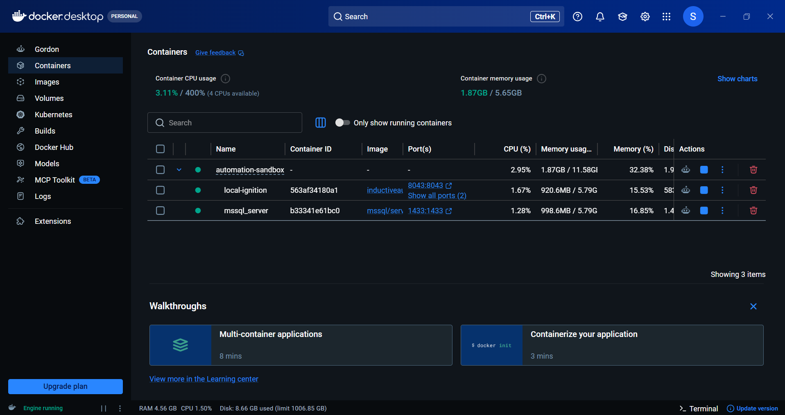
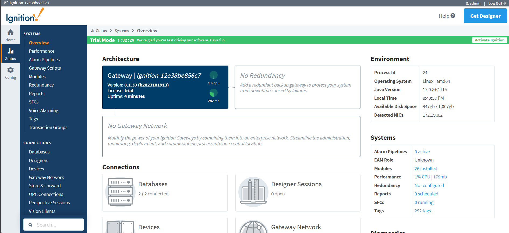
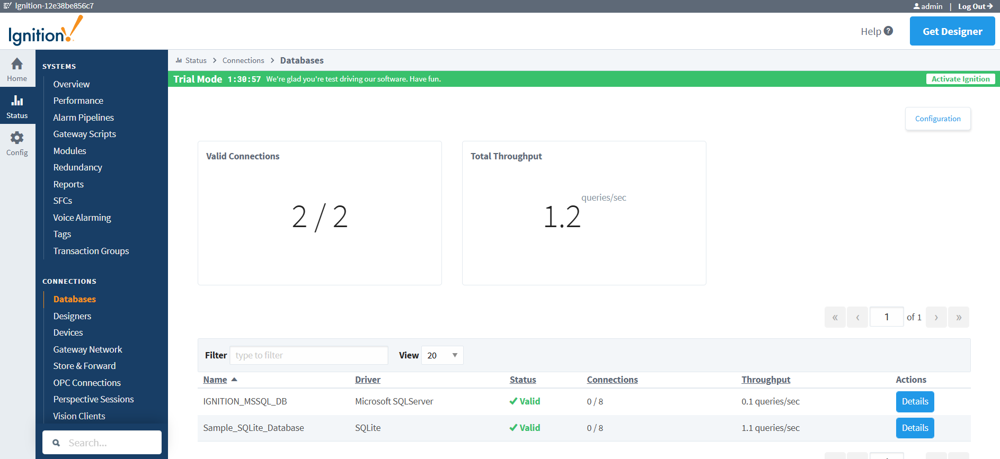
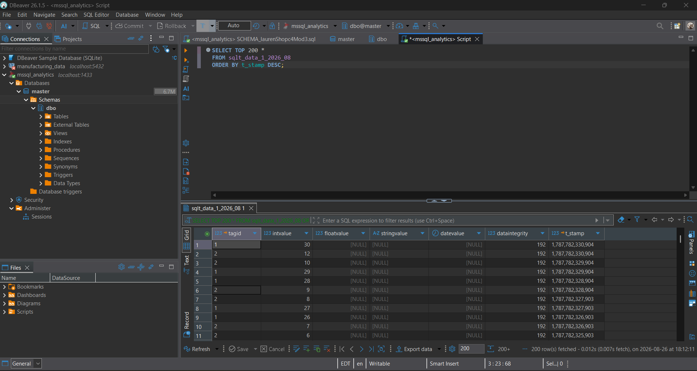

# industrial-scada-docker-lab
Containerized Ignition SCADA and MS SQL time-series data pipeline simulating multi-node CIP routing

Project Overview: Industrial Automation Sandbox

Containerized infrastructure running dual Docker services: Ignition Gateway (SCADA) and Microsoft SQL Server.

Successfully established a live JDBC database connection between the Ignition Gateway and MS SQL for time-series logging.

Configured simulated Allen-Bradley PLC nodes (plc1 and plc2) to test and practice Common Industrial Protocol (CIP) multi-hop routing paths.

### Pipeline Verification & Data Flow

#### 1. Container Orchestration & Docker Setup

#### 2.  Gateway Status & OPC UA Device Settings

#### 3. Database Connection Configuration

#### 4. Real-Time Perspective Power Chart

#### 5. MS SQL Server Time-Series Storage (`sqlt_data_1`)

